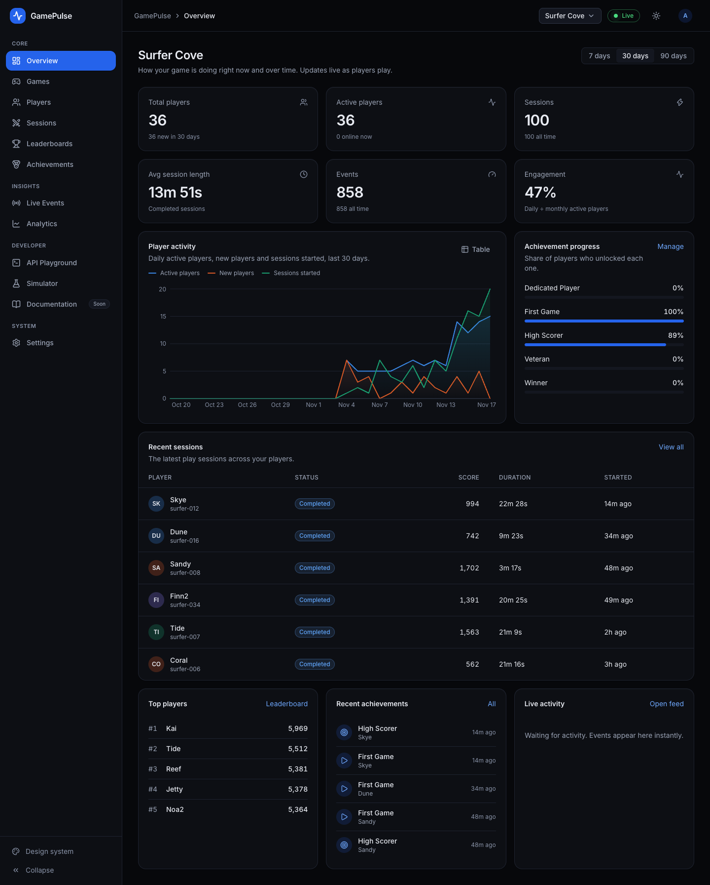
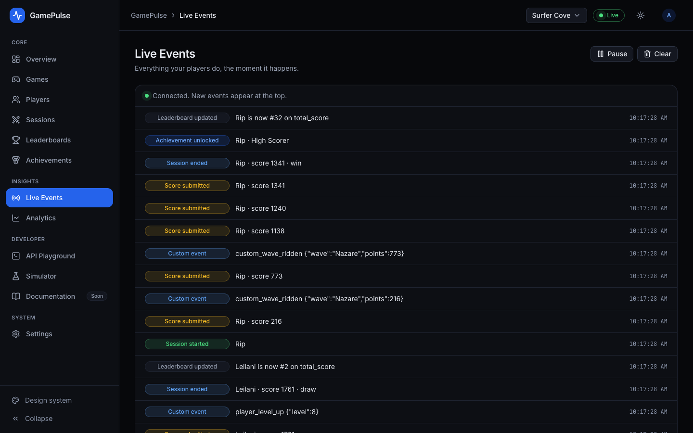
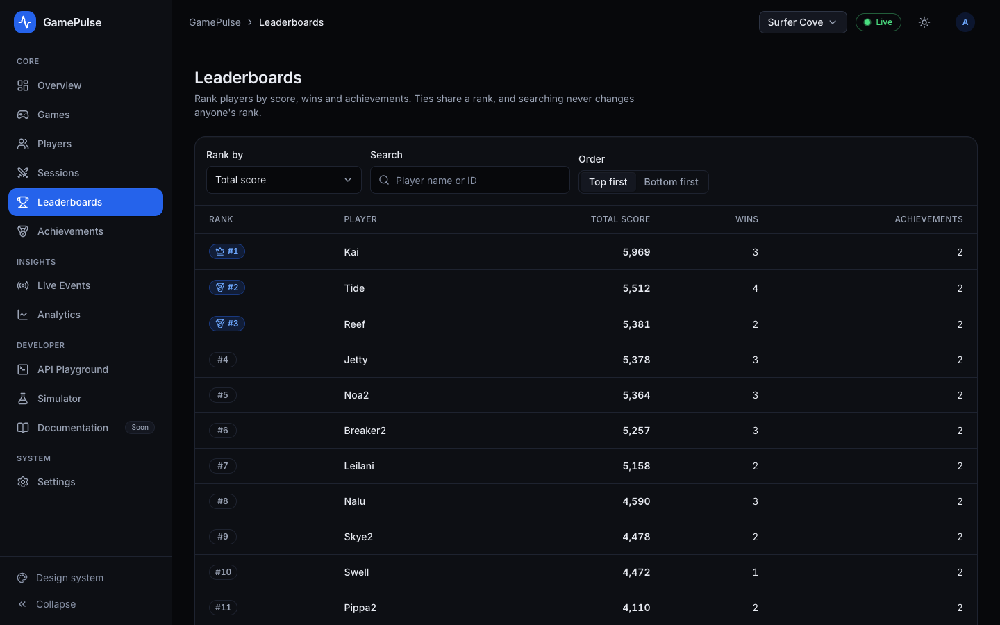
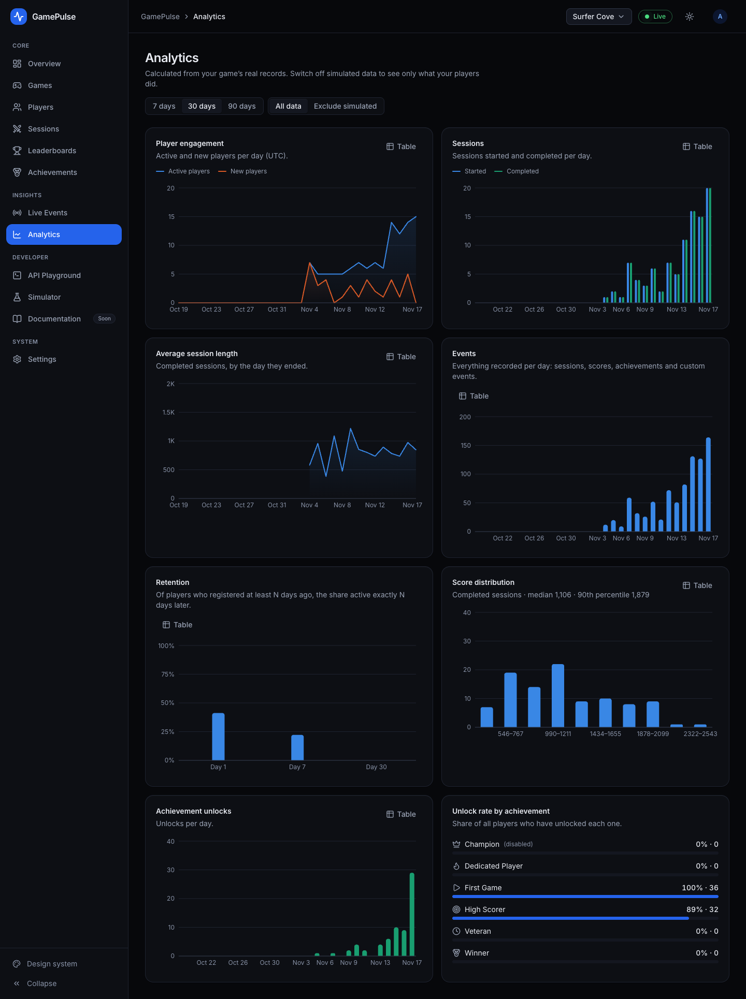
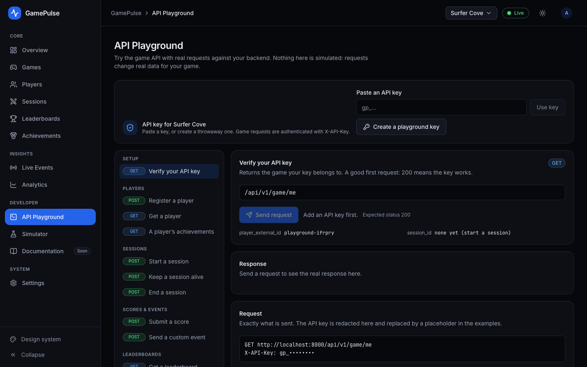
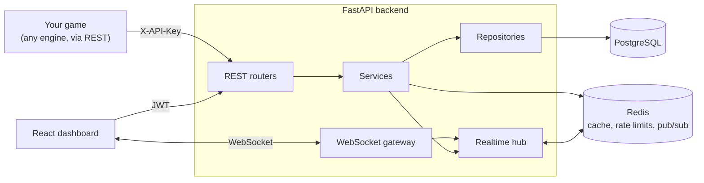

# GamePulse

[](https://github.com/Divine-K/gamepulse/actions/workflows/ci.yml)

**A multi-tenant backend and real-time analytics dashboard for games.** Game developers plug a game in with one API key and get player management, session tracking, leaderboards, achievements, event ingestion and live analytics, without building any of it themselves.



**Live demo:** the dashboard is at <https://gamepulse-71j.pages.dev> and the API at <https://gamepulse-api-xbkp.onrender.com>. Both run on free tiers, so the API sleeps when idle: the first request after a quiet period can take up to a minute. Create an account, add a game, and press **Run a quick demo** in the Simulator to watch it work.

## What it does

| | |
|---|---|
| **Player management** | Register players by your own ID, track profiles, stats and activity. Registration is idempotent. |
| **Sessions** | Start, heartbeat and end sessions. Abandoned sessions are closed automatically. |
| **Leaderboards** | Total score, best score, wins, achievements, sessions or any custom score category. Ties share a rank. |
| **Achievements** | Six built-in achievements per game (one opt-in) plus your own, awarded automatically when a session ends. |
| **Events** | Send level-ups and any `custom_*` event with a JSON payload. The platform records its own events transactionally. |
| **Analytics** | Active players, engagement, day-1/7/30 retention, score distribution and achievement rates, all computed from real records. |
| **Live feed** | Every event reaches the dashboard over a WebSocket the moment it happens. |
| **Developer tools** | An API playground that sends real requests, and a simulator that plays a game for you. Simulated data is always labelled and can be filtered out. |

<table>
  <tr>
    <td></td>
    <td></td>
  </tr>
  <tr>
    <td></td>
    <td></td>
  </tr>
</table>

More screens: [players](docs/screenshots/players.png), [sessions](docs/screenshots/sessions.png), [achievements](docs/screenshots/achievements.png), [games](docs/screenshots/games.png). The screenshots show the example game playing against a real local stack; see [Demo data](docs/getting-started.md#demo-data-and-screenshots) for exactly how they were made.

## How it works



Two callers share one service layer: developers use the dashboard with a JWT, games use an API key that identifies the game and its owner. Every query is scoped to a game, and tenant isolation is enforced in the backend and covered by cross-tenant tests. See [architecture](docs/architecture.md) for the design and its 15 decision records.

## Connect a game in two minutes

Create a game in the dashboard, open it, then create an API key (the key is shown once, so copy it). Then, from any language:

```bash
export KEY=gp_xxxxxxxxxxxx_...        # your API key
API=https://gamepulse-api-xbkp.onrender.com/api/v1/game

curl -X POST $API/players -H "X-API-Key: $KEY" -H "Content-Type: application/json" \
  -d '{"external_id": "player-1", "username": "Kai"}'

curl -X POST $API/sessions -H "X-API-Key: $KEY" -H "Content-Type: application/json" \
  -d '{"player_external_id": "player-1"}'
```

Or run the bundled example game, which plays itself through the API and fills the dashboard:

```bash
GAMEPULSE_KEY=$KEY python examples/surfer/play.py --base-url https://gamepulse-api-xbkp.onrender.com --players 12
```

The full walkthrough, with a copy-paste client, is in the [integration guide](docs/integration-guide.md). To see GamePulse with a **real** game and real players, the [Lichess bridge](docs/real-game-demo.md) streams live chess games from lichess.org into a dashboard, with no account or key needed.

## Run it locally

You need Docker, Python 3.13 and Node 24.

```bash
cp .env.example .env                 # then set real secrets (see docs/getting-started.md)
docker compose up -d                 # PostgreSQL and Redis
cd backend && python3.13 -m venv .venv && source .venv/bin/activate
pip install -r requirements-dev.txt && alembic upgrade head
uvicorn app.main:app --reload        # API on http://localhost:8000, interactive docs at /docs
```

```bash
cd frontend && npm install && npm run dev      # dashboard on http://localhost:5173
```

Step-by-step instructions, the production Docker stack and troubleshooting are in [getting started](docs/getting-started.md).

## Tech stack

| Layer | Technology |
|---|---|
| API | Python 3.13, FastAPI, SQLAlchemy 2 (async), Alembic, Pydantic 2 |
| Data | PostgreSQL 17, Redis 7 (cache, rate limiting, live tracking, pub/sub) |
| Auth | Argon2id passwords, signed JWTs, hashed API keys that are shown once |
| Real time | WebSockets over Redis pub/sub, so it works across several API processes |
| Dashboard | React 19, TypeScript, Vite, Tailwind CSS 4, Motion, Recharts, TanStack Query, React Hook Form, Zod |
| Quality | Pytest + HTTPX, Vitest, Playwright, Ruff, ESLint, Bandit, pip-audit, npm audit |
| Delivery | Multi-stage Docker images, nginx, GitHub Actions, free-tier hosting on Cloudflare Pages, Render and Neon |

## Engineering highlights

- **Multi-tenant by construction.** Repositories always take a `game_id`, composite foreign keys stop a row from pointing at another game's data, and foreign or unknown IDs return the same `404`. Cross-tenant tests try to read and write every resource.
- **Safe to retry.** Session starts and event ingestion accept an `Idempotency-Key`. Row locks keep concurrent session starts and ends consistent.
- **Real analytics, not mock numbers.** Every figure comes from `events`, `game_sessions`, `players` and `player_achievements`, with the definitions written down in the [API guide](docs/api-guide.md).
- **Real time that scales out.** Each API process subscribes to Redis and fans events out to its own WebSocket clients, with backpressure and clear close codes. The active-player index rebuilds from PostgreSQL if Redis loses it.
- **Hardened.** Request-size limits, security headers, no-store caching on JSON, a strict Content-Security-Policy at the edge, rate limiting, and a production start-up check that refuses a placeholder secret. See [security](docs/security.md).
- **Tests are checked by breaking the code.** A test only counts once deliberately breaking the behaviour it covers makes it fail. See [testing](docs/testing.md).
- **Fast.** On a laptop with one API worker: 96 full session cycles per second (p95 292 ms), and the analytics overview in 52 ms at 2,000 players, 20,000 sessions and about 60,000 events.

## Quality

| Check | Result |
|---|---|
| Backend tests (real PostgreSQL and Redis) | 219 passing |
| Frontend unit and component tests | 102 passing |
| End-to-end tests (Playwright, real Chrome, isolated stack) | 21 passing |
| Lint, formatting, type check | clean (Ruff, ESLint, Prettier, TypeScript) |
| Dependency and security scans | `npm audit` 0, `pip-audit` clean, `bandit` clean |

GitHub Actions runs all of this on every push, including a job that builds the Docker images and runs the browser suite against the containers.

## Documentation

| Guide | What is in it |
|---|---|
| [Getting started](docs/getting-started.md) | Local setup, the production Docker stack, demo data, troubleshooting |
| [Integration guide](docs/integration-guide.md) | Connect a game: every call, a copy-paste client, error handling |
| [Real game demo](docs/real-game-demo.md) | Live chess from Lichess mirrored into GamePulse in real time |
| [API guide](docs/api-guide.md) | Conventions, endpoints, events and analytics definitions |
| [Architecture](docs/architecture.md) | System design, real-time design, frontend, decision records |
| [Database schema](docs/database-schema.md) | ER diagram, tables, constraints, indexes |
| [Security](docs/security.md) | Threat review and the hardening applied |
| [Testing](docs/testing.md) | Test strategy, findings, performance results |
| [Deployment](docs/deployment.md) and [free-tier deploy](docs/deploy-free-tiers.md) | Docker images, configuration, step-by-step free hosting |
| [Roadmap](docs/roadmap.md) | What is built, known limits and what comes next |

## Repository layout

| Path | Purpose |
|---|---|
| `backend/` | FastAPI application, Alembic migrations, tests, scripts (smoke, load test, demo seeding) |
| `frontend/` | React and TypeScript dashboard, unit tests, Playwright suite, nginx config |
| `examples/surfer/` | A pretend game and a dependency-free Python client for the Game API |
| `examples/lichess/` | A bridge that mirrors live Lichess chess games into GamePulse |
| `docs/` | Documentation and screenshots |
| `deploy/` and `render.yaml` | Cloudflare Pages build and Render blueprint for the free-tier deployment |
| `.github/workflows/` | CI pipeline |

## Author

Built by Kushal Pokhrel ([@Divine-K](https://github.com/Divine-K)).
