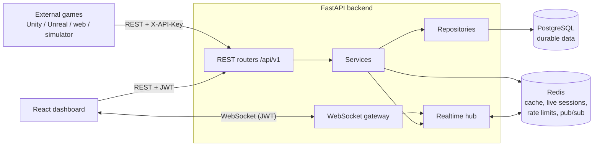
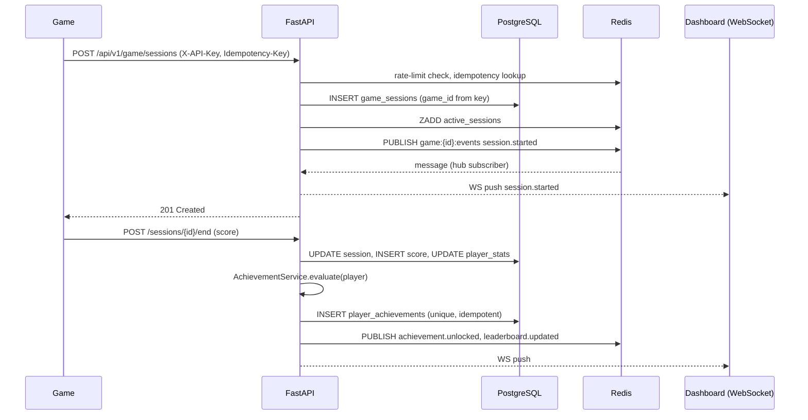
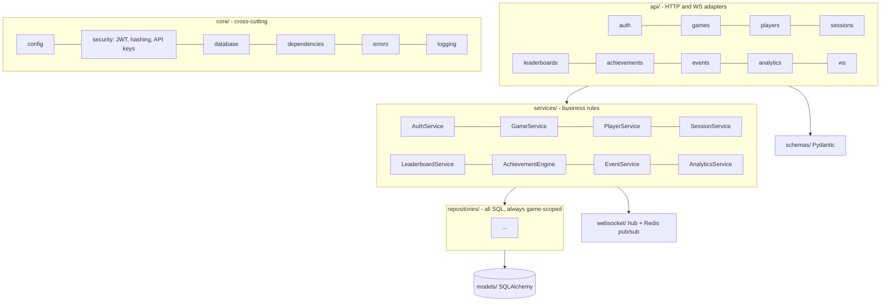
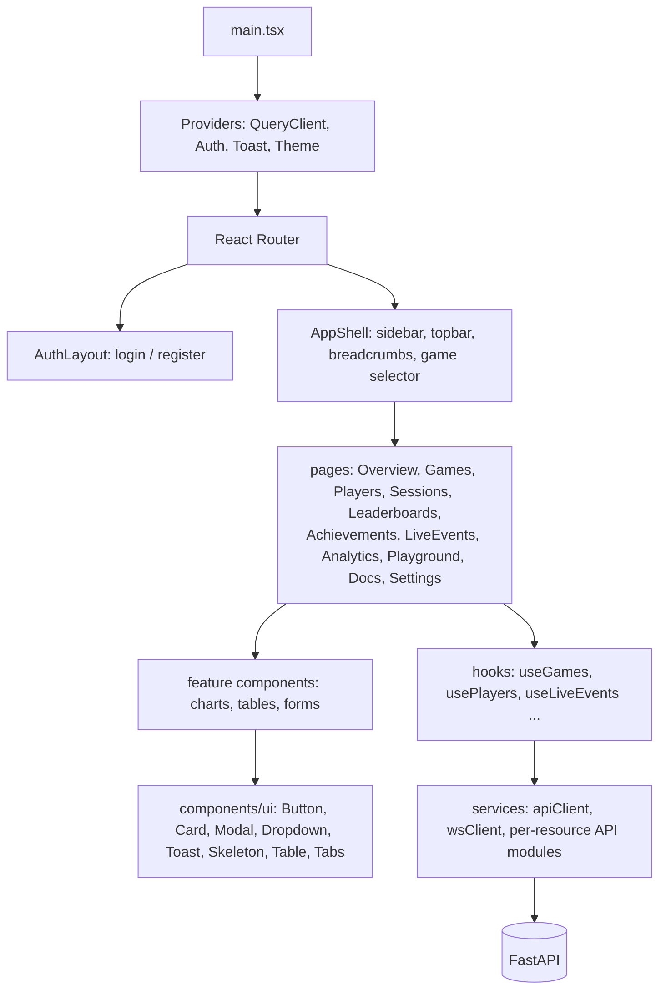

# GamePulse Architecture

## 1. System overview

**Two callers, two auth schemes, one set of services.**

| Caller | Credential | Resolves to | Routes |
|---|---|---|---|
| Developer (dashboard) | JWT bearer token | `Developer`, then ownership check on `game_id` | `/api/v1/auth`, `/api/v1/developers`, `/api/v1/games/{game_id}/...` |
| Game (server or client) | `X-API-Key` header | `Game` (key identifies the game and its owner) | `/api/v1/game/...` |

Both route groups call the same service layer. The service receives an already-authorized `GameContext(game_id)` and never trusts a `game_id` from a request body.

## 2. How the pieces communicate

- **PostgreSQL** is the source of truth. All analytics are computed from its rows.
- **Redis** is never the only copy of important data. If Redis is flushed, the system recovers: active sessions are rebuilt from `game_sessions WHERE status='active'`, and caches refill on demand.
- **WebSocket** messages are notifications. The dashboard refetches via REST through TanStack Query after a push, so a missed message cannot corrupt state.

## 3. Backend module design

Rules:
1. Routers only parse input, call a service, and shape output. No SQL and no business rules.
2. Services own transactions and rules: session state machine, achievement evaluation, idempotency.
3. Repositories take `game_id` as a required argument for every tenant-owned table. There is no "get player by id" without a game.
4. `schemas/` (Pydantic) are the API contract. `models/` (SQLAlchemy) are persistence. They are never the same class.

## 4. Multi-tenancy and data isolation

Four layers, each enforced in the backend:

1. **Authentication resolves the tenant.** An API key maps to exactly one `game_id`. A JWT maps to a `developer_id`, and the `get_owned_game` dependency checks `games.developer_id == developer_id` before any `/games/{game_id}/...` handler runs. A foreign game returns **404**, not 403, so existence isn't leaked.
2. **Repositories require `game_id`.** Every query on a tenant table filters on it.
3. **Composite foreign keys.** For example `game_sessions(game_id, player_id)` references `players(game_id, id)`, so the database rejects a session that links one game's player to another game's session even if application code has a bug.
4. **Tests.** Each endpoint has a cross-tenant test: developer A, game A's key, and developer B must all fail to read or write game B's data.

Postgres Row-Level Security was considered and deferred (see ADR-004).

## 5. Real-time design

- Redis pub/sub channel per game: `gp:game:{game_id}:events`. Services publish JSON envelopes `{type, game_id, data, ts}`.
- Each backend process runs one `RealtimeHub` that pattern-subscribes (`gp:game:*:events`) at startup and forwards each message to its local WebSocket clients of that game. Subscribing once at startup, instead of per game on demand, avoids subscribe/unsubscribe races and still works across any number of API processes because Redis fans out.
- Each connection has a bounded queue (256 messages). A client that falls behind is dropped with close code 1013 rather than letting it hold memory or stall others; it reconnects and refetches over REST.
- **Dashboard WebSocket:** `WS /api/v1/ws/games/{game_id}`. The client connects, then sends `{"type":"auth","token":"<jwt>"}` as the first message within 5 seconds. A token in the URL would leak into logs, so none is used. The server verifies ownership, replies `{"type":"ready","active_players":N}` and then streams. `{"type":"ping"}` is answered with `{"type":"pong"}`. Close codes: 4400 bad first message, 4401 unauthorized, 4404 game not found (same code for foreign and unknown games), 4408 auth timeout, 4429 too many connections (default 20 per game per process), 1013 client too slow.
- Client reconnect: exponential backoff with jitter, then a REST refetch after reconnect.
- **Active players:** Redis sorted set `gp:game:{id}:active` (member = player id, score = last heartbeat). A player counts as active while the score is within the session timeout (default 15 minutes), so crashed clients stop counting even before the reaper runs. The set is rebuilt from `game_sessions` at startup, and reads fall back to Postgres if Redis is down. A background reaper marks timed-out sessions `abandoned` and publishes `session.abandoned`.
- **Leaderboard cache:** pages are cached in Redis under `gp:game:{id}:lb:{version}:{hash}`. Any change that can alter ranks (session end, score submission) bumps the per-game version, which makes every older entry unreachable. A 30 s TTL is only a safety net.
- **Best-effort:** publishing, tracking and caching never raise into a request. If Redis is down, game API calls still succeed and the dashboard recovers by refetching.
- Event envelope: `{id, type, game_id, ts, is_simulated, data}`. Types: `player.registered`, `session.started`, `session.ended`, `session.abandoned`, `score.submitted`, `achievement.unlocked`, `leaderboard.updated` (`event.received` arrives with event ingestion). Idempotent replays emit nothing.

## 6. Frontend architecture

- **State:** server state in TanStack Query. Auth and selected game live in React context. No global store.
- **Design tokens** are CSS variables (colour, type, spacing, radius, shadow, motion durations), exposed to Tailwind via `@theme`.
- **Motion** is wrapped in small components (`PageTransition`, `FadeIn`, `Presence`) that respect `prefers-reduced-motion`.
- **Validation:** Zod schemas + React Hook Form; API response types in `types/`.

## 7. Architecture Decision Records

| # | Decision | Rationale | Trade-off |
|---|---|---|---|
| ADR-001 | **Async stack**: async SQLAlchemy 2 + psycopg 3 + `redis.asyncio` | WebSockets and Redis pub/sub are natively async; one concurrency model | Slightly harder tests (pytest-asyncio) |
| ADR-002 | **Layered architecture** (api → services → repositories) | Testable rules, no SQL in routers, isolation enforced in one place | More files than a flat app |
| ADR-003 | **API keys stored as SHA-256 hashes**, format `gp_<prefix>_<secret>`; prefix indexed for lookup | Keys are 256-bit random, so a fast hash is safe and cheap per request (Argon2 is for low-entropy passwords) | Secret shown once; lost key means rotate |
| ADR-004 | **App-level tenant isolation + composite FKs**, no Postgres RLS in the MVP | Simple, visible in code, testable. RLS needs per-request session variables and complicates pooling | Relies on discipline and tests; RLS is a future hardening |
| ADR-005 | **Passwords with Argon2id** (pwdlib) | Current best practice | Slower login by design |
| ADR-006 | **JWT access tokens only** (60 min, HS256) | Enough for MVP. Refresh-token rotation is future work | Re-login after expiry |
| ADR-007 | **Idempotency via `Idempotency-Key` header** (unique per game) for session start and event ingestion | Games retry on flaky networks | Keys stored in a unique column |
| ADR-008 | **Denormalized `player_stats` row** updated in the same transaction as session end | O(1) leaderboard reads; avoids aggregating millions of rows | Must stay consistent; covered by tests |
| ADR-009 | **Leaderboards are metric-based** (`total_score`, `best_score`, `wins`, `achievements`), with a `category` on score entries | New ranking categories need no schema change | Rank computed with window functions + Redis cache |
| ADR-010 | **Events stored as JSONB payload + indexed type/time** | Custom event types without migrations | Payload validated per known type, free-form for `custom_*` |
| ADR-011 | **UUID primary keys** | Safe to expose, no enumeration | Larger indexes |
| ADR-012 | **`is_simulated` flag** on players, sessions and events | Simulator data is clearly labelled and can be cleaned without touching real data | One more column |
| ADR-013 | **Zero-cost constraint**: only open-source libraries and free tiers; no paid APIs, no paid LLM or AI calls inside the app | Personal portfolio project with no budget | Free hosting tiers sleep, are rate-limited, and may require a card for identity verification, so we check this before choosing a host in Phase 12 |
| ADR-014 | **One pattern subscription per process** feeding a local per-game fan-out | Simpler and race-free versus per-game subscribe/unsubscribe; works across processes | Each process receives all games' messages and filters locally |
| ADR-015 | **Real-time is best-effort; Postgres is the source of truth** | A Redis outage must not fail game requests; clients refetch after reconnect | Events can be missed, so the UI must refetch on reconnect |

## 8. Frontend implementation notes (Phase 8)

- **Design tokens** live in `frontend/src/index.css` as CSS variables (surfaces, borders, text, accent, status, shadow, motion). Tailwind exposes them as semantic utilities (`bg-surface`, `text-muted`, `border-line`), so components never use raw colors and dark/light stay consistent. The `/design` route documents them.
- **State:** server state in TanStack Query; auth, selected game, theme and the live stream are React contexts. The JWT is kept in `sessionStorage` (survives a refresh, not a closed tab); a 401 on an authenticated request signs the user out.
- **Live stream:** one `GameStream` per selected game, shared by all pages. It authenticates with its first message, reconnects with jittered backoff, detects half-open connections with ping/pong, and refetches REST data after any reconnect (ADR-015).
- **Accessibility:** native `<dialog>` for modals (focus trap and Esc from the platform), labelled form fields with `aria-describedby`/`role="alert"` errors, skip link, `aria-live` toasts, visible focus ring, and `MotionConfig reducedMotion="user"` plus a CSS reduced-motion rule.
- **Honesty about scope:** pages that are not built yet show a "Soon" badge and a "Not built yet" state instead of fake content.

## 9. Dashboard implementation notes (Phase 9)

- **Query keys and live refresh.** Every game-scoped query starts with `['game', gameId, ...]`. The shared stream invalidates that single prefix (at most once per 1.5 s) whenever an event arrives, so all open pages refresh themselves from REST, the source of truth. Pagination and filters use `keepPreviousData`, so tables don't flash while loading.
- **Page state in the URL.** Search, sort, page, tab, range and filters live in the query string (`useUrlState`), so views are shareable, survive a refresh and work with the back button.
- **Charts** follow the data-viz rules in the design system: a validated categorical palette (checked against both card surfaces), 2px lines with a 10% area wash, thin 4px-rounded columns, hairline grid, round y-axis ticks, crosshair/tooltip on hover, a legend for every multi-series chart, and a **Table** toggle on every chart so exact values never depend on colour or hover.
- **Secrets.** API key secrets exist only in component state while the show-once dialog is open. Lists show only the key prefix. Destructive actions (revoke, rotate, delete game) always go through a confirmation dialog, and deleting a game requires typing its name.
- **Performance.** Routes are lazy-loaded and third-party code is split into cached vendor chunks (charts, motion, forms, react), so the first load downloads about 45 kB of app code plus shared vendors, and the charting library only loads on pages that draw charts.
