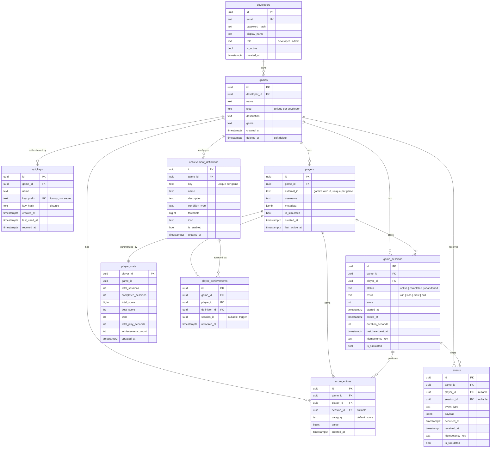
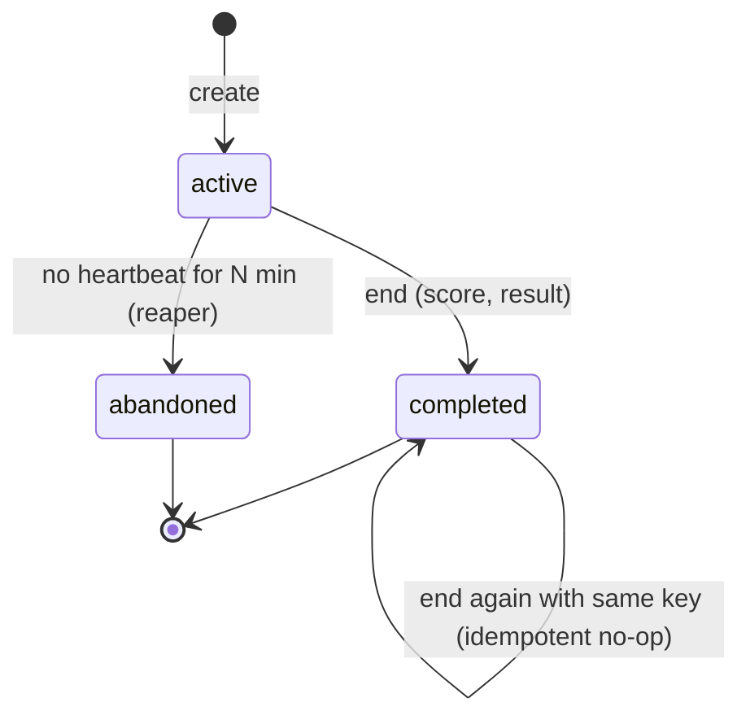

# Database Schema

PostgreSQL 17. UUID primary keys. All timestamps are `timestamptz` stored in UTC. Migrations are managed by Alembic.

## ER diagram

## Tenant integrity constraints

The ER diagram does not show these. They matter most.

| Constraint | Purpose |
|---|---|
| `players UNIQUE (game_id, id)` | Target for composite foreign keys |
| `players UNIQUE (game_id, external_id)` | A game's own player id is unique inside that game and may repeat across games |
| `game_sessions FOREIGN KEY (game_id, player_id) REFERENCES players (game_id, id)` | A session cannot connect game A to game B's player |
| Same composite FK on `score_entries`, `events`, `player_achievements`, `player_stats` | Same guarantee everywhere |
| `game_sessions UNIQUE (game_id, id)` and composite FK from `score_entries`/`events` to it | Child rows must share the session's game |
| `achievement_definitions UNIQUE (game_id, key)` | Stable per-game achievement keys |
| `player_achievements UNIQUE (player_id, definition_id)` | **Duplicate-award prevention** enforced by the database |
| `events UNIQUE (game_id, idempotency_key) WHERE idempotency_key IS NOT NULL` | Idempotent ingestion |
| `game_sessions UNIQUE (game_id, idempotency_key) WHERE idempotency_key IS NOT NULL` | Idempotent session creation |
| `games UNIQUE (developer_id, slug) WHERE deleted_at IS NULL` | Slugs are unique per developer among live games |
| `api_keys UNIQUE (key_prefix)` | Constant-time lookup of the key's row |
| `CHECK (status IN ('active','completed','abandoned'))` and `CHECK (ended_at IS NULL OR ended_at >= started_at)` | State and time sanity |
| Partial unique index on `game_sessions (game_id, player_id) WHERE status='active'` | One active session per player per game (rule can be relaxed per game later) |

## Session state machine

Invalid transitions (for example ending an abandoned session) return `409 Conflict`.

## Indexes (initial)

- `players (game_id, last_active_at DESC)`, `players (game_id, username)` for search
- `game_sessions (game_id, status)`, `(game_id, started_at DESC)`, `(player_id, started_at DESC)`
- `events (game_id, occurred_at DESC)`, `(game_id, event_type, occurred_at DESC)`
- `score_entries (game_id, category, value DESC)`
- `player_stats (game_id, total_score DESC)`, `(game_id, best_score DESC)`, `(game_id, wins DESC)`

## Achievement conditions

`condition_type` is an enum evaluated by the `AchievementEngine`:

| Type | Meaning | Example |
|---|---|---|
| `sessions_completed` | `completed_sessions >= threshold` | First Game (1), Dedicated Player (10) |
| `score_reached` | any single session score `>= threshold` | High Scorer |
| `total_play_seconds` | accumulated duration `>= threshold` | Veteran |
| `wins` | `wins >= threshold` | Winner |
| `leaderboard_rank` | current rank `<= threshold` | Champion |

New condition types are added by registering an evaluator function, with no schema change.

## Analytics sources

All metrics are SQL aggregates over the tables above: DAU and MAU from `game_sessions`/`events` distinct players, average duration from completed sessions, retention from first-session cohorts, score distributions via `width_bucket` on `score_entries`, and currently active players from Redis, with a Postgres fallback.

## Deferred (not in the MVP)

`leaderboard_snapshots` (historical rankings; added in Phase 6 if time allows), event table partitioning by month, Postgres RLS, organizations and subscription plans.
