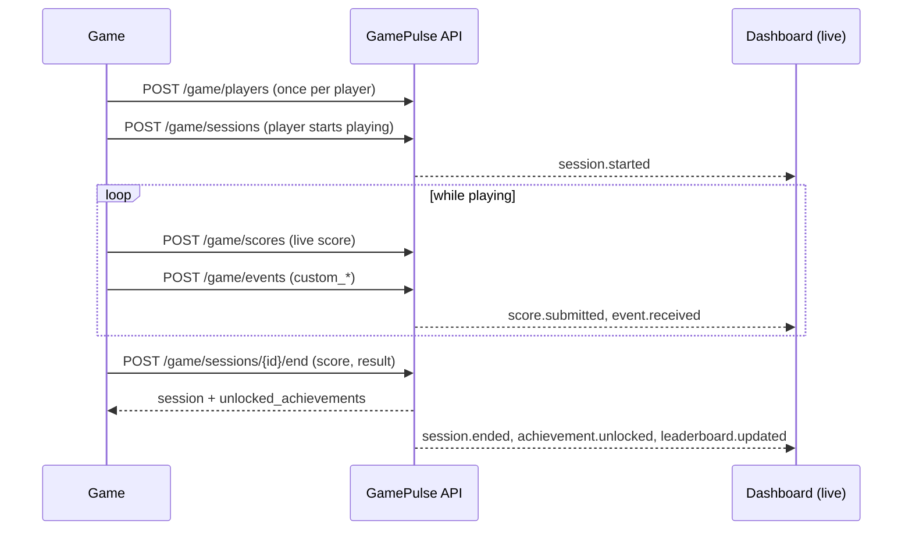

# Integration guide: connect a game to GamePulse

This guide takes a game from nothing to a live dashboard. It works with any engine or language, because everything is plain HTTPS and JSON. The responses below are real output from the API.

## The idea

- A **game** belongs to one developer. Its **API key** identifies the game, so game requests never carry a game ID.
- Your game keeps its own player IDs. You send them as `external_id`; GamePulse never asks you to change them.
- You report what happens: players, sessions, scores, and your own events. GamePulse computes the rest (stats, leaderboards, achievements, analytics) and pushes everything to the live dashboard.



## 1. Get an API key

1. Sign in to the dashboard and **create a game** (Games, then New game).
2. Open the game and **create an API key**. The full key (`gp_<12 hex>_<64 hex>`) is shown **once**; only its prefix is stored in readable form and the rest is a SHA-256 hash. Copy it now.
3. Treat it like a password: keep it on your game server or in a build secret, never in a public repository. If it leaks, **rotate** it (a new secret, the old one stops working immediately) or **revoke** it from the same screen.

```bash
export KEY=gp_xxxxxxxxxxxx_...
export API=https://gamepulse-api-xbkp.onrender.com/api/v1/game      # or http://localhost:8000/api/v1/game
```

Every request sends `X-API-Key: $KEY`. Check it first; a `200` with your game means it works:

```bash
curl $API/me -H "X-API-Key: $KEY"
```
```json
{ "id": "85f1b167-…", "name": "Guide Game", "slug": "guide-game", "description": "", "genre": null,
  "created_at": "2026-11-17T16:20:35.812258Z", "updated_at": "2026-11-17T16:20:35.812258Z" }
```

## 2. Register a player

Call this the first time you see a player, and any time you like afterwards: it is **idempotent** by `external_id`, so a repeat call returns the existing player.

```bash
curl -X POST $API/players -H "X-API-Key: $KEY" -H "Content-Type: application/json" \
  -d '{"external_id": "player-1", "username": "Kai", "metadata": {"board": "short"}}'
```
```json
{ "id": "ff91459a-…", "external_id": "player-1", "username": "Kai", "is_simulated": false,
  "metadata": {"board": "short"},
  "stats": {"total_sessions": 0, "completed_sessions": 0, "total_score": 0, "best_score": 0,
            "wins": 0, "total_play_seconds": 0, "achievements_count": 0} }
```

`metadata` is any JSON you want to keep with the player (up to a small size limit).

## 3. Play a session

A session is one stretch of play. A player can have **one active session at a time**.

```bash
# start (add an Idempotency-Key so a retried request cannot start two sessions)
curl -X POST $API/sessions -H "X-API-Key: $KEY" -H "Content-Type: application/json" \
  -H "Idempotency-Key: $(uuidgen)" -d '{"player_external_id": "player-1"}'
```
```json
{ "id": "b0aad067-…", "status": "active", "result": null, "score": 0,
  "started_at": "2026-11-17T16:20:36.296003Z", "ended_at": null, "duration_seconds": null,
  "player": {"external_id": "player-1", "username": "Kai", …} }
```

While the player plays, send the **live score** and any **events**:

```bash
SID=b0aad067-…
curl -X POST $API/scores -H "X-API-Key: $KEY" -H "Content-Type: application/json" \
  -d "{\"player_external_id\": \"player-1\", \"value\": 1200, \"session_id\": \"$SID\"}"

curl -X POST $API/events -H "X-API-Key: $KEY" -H "Content-Type: application/json" \
  -d "{\"event_type\": \"custom_boss_defeated\", \"player_external_id\": \"player-1\", \"session_id\": \"$SID\", \"payload\": {\"boss\": \"kraken\"}}"
```

- **Scores:** `category` defaults to `score`. Any other name (for example `"fastest_lap_ms"`) creates a separate ranking, available as the leaderboard metric `category:fastest_lap_ms`.
- **Events:** the type must be `player_level_up` (payload `{"level": 5}`) or start with `custom_`. Session start, session end, score and achievement events are recorded by the platform itself and cannot be sent (they would be double counted). `occurred_at` is optional and must be within the last 7 days.
- **Long sessions:** send `POST /sessions/{id}/heartbeat` every minute or so. A session with no heartbeat for the configured timeout (default 15 minutes) is closed as `abandoned`.

End the session with the final score and result (`win`, `loss` or `draw`):

```bash
curl -X POST $API/sessions/$SID/end -H "X-API-Key: $KEY" -H "Content-Type: application/json" \
  -d '{"score": 1200, "result": "win"}'
```
```json
{ "id": "b0aad067-…", "status": "completed", "result": "win", "score": 1200, "duration_seconds": 0,
  "unlocked_achievements": [
    {"key": "high_scorer", "name": "High Scorer", "icon": "target"},
    {"key": "first_game",  "name": "First Game",  "icon": "play"} ] }
```

`unlocked_achievements` lists what this session earned, so your game can show a "You unlocked High Scorer" toast. Achievements are permanent and awarded once per player.

## 4. Show a leaderboard in your game

```bash
curl "$API/leaderboards/total_score?limit=10" -H "X-API-Key: $KEY"
```
```json
{ "items": [ {"rank": 1, "value": 1200,
              "player": {"external_id": "player-1", "username": "Kai", …},
              "stats": {"total_score": 1200, "wins": 1, "achievements_count": 2, …}} ],
  "total": 1, "limit": 3, "offset": 0, "metric": "total_score", "period": "all" }
```

Metrics: `total_score`, `best_score`, `wins`, `achievements`, `completed_sessions` or `category:<name>`. Ties share a rank. Use `?q=` to search by name and `GET /leaderboards/{metric}/players/{external_id}` for one player's rank.

## 5. Handle errors and limits

Every error has one shape, so one handler is enough:

```json
{ "error": { "code": "session_already_active",
             "message": "This player already has an active session. End it or let it time out.",
             "details": [{"session_id": "eb6c0226-…"}],
             "request_id": "f8239098-…" } }
```

| Status | Code (example) | What to do |
|---|---|---|
| `401` | `invalid_api_key` | The key is missing, wrong or revoked. Do not retry. |
| `404` | `not_found` | The player, session or resource is not in this game. |
| `409` | `session_already_active` | End or resume the session in `details` before starting another. |
| `422` | `validation_error`, `reserved_event_type` | Fix the request; `details` says which field. |
| `429` | `rate_limited` | Wait `Retry-After` seconds, then retry. The default is 600 requests per minute per game. |
| `5xx` | | Retry with backoff. Reuse the same `Idempotency-Key` so a retry cannot duplicate a session or event. |

Quote the `request_id` (also in the `X-Request-ID` response header) when you investigate a problem: it matches the server's log line.

**Cold starts on free hosting.** The free-tier API sleeps when idle and takes up to a minute to wake. Use a generous timeout (the example client uses 90 s) and retry the first request.

## 6. A copy-paste client

[`examples/surfer/gamepulse_client.py`](../examples/surfer/gamepulse_client.py) is a single file with no dependencies (Python 3.10+). It covers every call above, retries on `429` using `Retry-After`, adds idempotency keys, and raises `GamePulseError` with the status and code.

```python
from gamepulse_client import GamePulse

api = GamePulse("https://gamepulse-api-xbkp.onrender.com", "gp_xxxxxxxxxxxx_...")
api.register_player("player-1", "Kai")
session = api.start_session("player-1")
api.submit_score("player-1", 1200, session_id=session["id"])
api.send_event("custom_boss_defeated", "player-1", session["id"], {"boss": "kraken"})
done = api.end_session(session["id"], score=1200, result="win")
print([a["name"] for a in done["unlocked_achievements"]])
```

From another language, the same calls are one `POST` each; use your engine's HTTP client (Unity `UnityWebRequest`, Godot `HTTPRequest`, `fetch` in JavaScript, and so on).

## 7. Try it end to end: the Surfer example

[`examples/surfer/play.py`](../examples/surfer/play.py) is a pretend game that plays itself: surfers register, ride waves (scores and `custom_wave_ridden` events), sometimes level up, and finish with a win, loss or draw.

```bash
export GAMEPULSE_KEY=gp_xxxxxxxxxxxx_...
python examples/surfer/play.py --players 12 --rounds 3              # local API
python examples/surfer/play.py --base-url https://gamepulse-api-xbkp.onrender.com --players 12
```

Open the dashboard while it runs: the Live Events page fills in as it plays, then Overview, Leaderboards and Analytics show the result. A test in the backend suite runs this example against a real server, so it stays correct as the API evolves.

For a **real** game, see the [Lichess bridge](real-game-demo.md): it follows live chess games on lichess.org and reports them through the same API.

## 8. Good practice

- **Send from your server when you can.** A key inside a shipped client can be extracted. For a client-side game, send through your own backend.
- **One key per environment** (development, staging, production) with a clear name, so you can revoke one without touching the others.
- **Keep payloads small.** Custom event payloads are limited to 8 KB; send identifiers and numbers, not blobs.
- **Use `custom_` names consistently** (`custom_boss_defeated`, not `custom_BossDefeated`): types are lowercase letters, digits and underscores.
- **Test with simulated data.** The dashboard's Simulator and API Playground clearly separate test data from real data; the analytics pages have an "Exclude simulated" switch.
